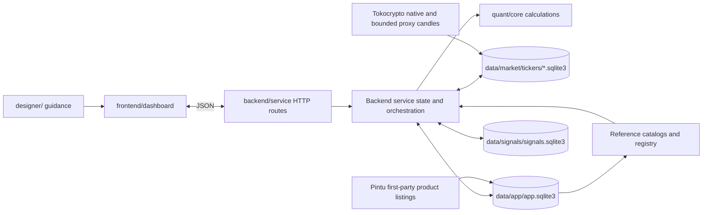

# Current architecture

The project is organized around ownership boundaries: designers define UI guidance, the frontend renders the dashboard, the backend serves the application and owns SQLite access, and the quant core owns quantitative calculations. SQLite holds durable market history, registered instruments, strategy plans, and ingestion status. There is no simulated portfolio, paper-trading UI, or order-placement API.

## Runtime flow

The dashboard is a static page shell. On startup the browser requests plans and the reference catalog from `GET /api/plans`; chart candles, registry data, scan status, and research views also come from Rust API routes. Structured API requests and responses use plain JSON with `application/json`. The browser keeps response data in memory for rendering and filtering, while SQLite remains the source of truth. Provider adapters may decode upstream responses in memory at the adapter boundary, validate them into typed records, and return application-owned JSON through the API.

`backend/service/src/routes.rs` owns HTTP parsing, response helpers, static assets, and route dispatch, with endpoint groups in `routes/control.rs`, `routes/plans.rs`, `routes/charts.rs`, and `routes/calculations.rs`. It serves dashboard files from `frontend/dashboard` while preserving the public `/web/...` asset URLs. Retired static backtest URLs redirect to the live dashboard instead of serving duplicated embedded history. `backend/service/src/main.rs` owns startup and shared state, with SQLite, plan, candle-history, research, and runtime responsibilities in sibling modules. `backend/service/src/master_data.rs` validates the SQLite reference catalog; `backend/service/src/instrument_registry.rs` is the registry façade over schema, catalog, API, and sync modules; `backend/service/src/pintu_listing.rs` validates Pintu first-party listings. Strategy families in `quant/core/src/strategies/` are exposed through `strategies.rs`. `quant/core` also contains indicators, risk calculations, and evidence calculations.

### Chart indicator contract

Chart candles group calculated study values under the JSON `indicators` object, keyed by study ID. The chart response's top-level `indicator_config` carries the settings used for those values. Nadaraya–Watson Envelope settings and method metadata are owned by its core config. The dashboard normalizes this typed shape once and shares line and band drawing primitives. This keeps indicator values out of SQLite and avoids adding one top-level candle field per study. New overlays still add their calculation and explicit rendering behavior; no dynamic plugin system is used.

The contract preserves the JSON-only API and SQLite-only history rules. Acceptance requires response metadata to match calculation defaults and the chart to keep its existing candle, empty, stale, and recovery behavior. Roll back the contract change if settings diverge from calculated values or the overlay breaks chart rendering.

## Source map

| Path | Responsibility |
|---|---|
| `designer/` | Design tokens, interaction flows, and UI guidance |
| `frontend/dashboard/templates/dashboard.html` | Static dashboard shell |
| `frontend/dashboard/styles/dashboard.css`, `frontend/dashboard/styles/dashboard_workspace.css`, `frontend/dashboard/styles/dashboard_components.css` | Dashboard appearance split into base, workspace, and component stylesheets |
| `frontend/dashboard/scripts/dashboard.js` | Native module entry point, ordered feature installation, and accessible load recovery |
| `frontend/dashboard/scripts/modules/` | Dashboard API, chart, plan, registry, research, diagnostics, and screener modules |
| `backend/service/src/routes.rs`, `routes/` | JSON API transport, responses, static assets, and endpoint groups |
| `backend/service/src/main.rs` and sibling modules | Service startup, SQLite access, explicit legacy split, plans, scans, chart history, and research |
| `backend/service/src/master_data.rs` | SQLite catalog loading, validation, and lookups |
| `backend/service/src/instrument_registry.rs`, `instrument_registry/` | SQLite instrument registry, seed-catalog migration, and source sync |
| `backend/service/src/wire.rs` | JSON request and response codec |
| `quant/core/src/strategies.rs`, `plans.rs`, `day_trade.rs` | Signal and plan calculations |
| `quant/core/src/indicators/` | Indicator calculations |
| `quant/core/src/risk/` | Position sizing and liquidity-risk calculations |
| `quant/core/src/evidence.rs` | Historical strategy evidence calculations |
| `data/market/tickers/` | Per-symbol SQLite history with canonical `bars`, `series`, and `ingestion_runs` |
| `data/app/app.sqlite3` | Registered instruments, catalogs, plans, evidence, listing status, and app metadata |
| `data/signals/signals.sqlite3` | Replaceable current screener rows and scan status; successful scans replace the snapshot |
| `tooling/start.bat`, `tooling/split-market-database.bat`, `tooling/harness.bat`, `tooling/check_source_line_limit.ps1` | Canonical launcher, explicit legacy split, source-size guard, and project checks |

## Dashboard module contract

The template loads only the native-module entry point. It fetches feature modules concurrently, then runs their named installers in dependency order. Each feature installer owns its mutable state. Reusable stateless helpers are exported and imported directly where appropriate; `api.js` owns JSON response handling and `chart-math.js` exports chart calculations. `runtime-context.js` remains a migration bridge for shared live bindings and tightly coupled legacy calls; it rejects duplicate owners while those features are separated. Template controls declare `data-dashboard-action` names, and the entry point validates those names against the installed feature bindings before delegating clicks and changes. A module import or installation failure leaves an accessible reload action visible.

## Storage and transport

SQLite is the only durable data store. `QUANT_MARKET_DIR` defaults to `data/market/tickers` and contains one history database per exact storage symbol. `QUANT_APP_DB` defaults to `data/app/app.sqlite3` and stores app-owned catalogs, registrations, plans, evidence, listing status, scheduler cursors, signal-alert history, indicator-model settings, and metadata. `QUANT_SIGNAL_DB` defaults to `data/signals/signals.sqlite3` and stores only the active screener snapshot and scan status. Successful scans replace that snapshot transactionally; failures preserve the last good rows and record an error. `QUANT_MARKET_DB` defaults to `data/market/market.sqlite3` and is only used as an explicit migration source. Runtime reference catalogs use app-database `reference_catalogs`; compiled seeds initialize that table. Plans retain a JSON detail payload for dashboard reconstruction, while query-critical registry and evidence fields use typed SQLite columns. The browser loads authoritative domain data from the backend and stores only disposable layout preferences. If the plans API is unavailable, the dashboard shows an error or stale-data message with a retry action instead of presenting a backend failure as an empty result.

JSON is the only structured payload format for application APIs, runtime messages, and SQLite payload columns. CBOR codecs and CBOR/Base64 envelopes are not part of the application. Retired imported backtests, artifact archives, and the unused validation database have been removed. The legacy split and per-symbol sharding are explicit offline migrations. Stop the service, run the split command if app-owned tables remain, then run the sharding command. Normal startup refuses an incomplete layout and never migrates implicitly.

The market scheduler selects active registered tickers independently of exchange. Tokocrypto's adapter discovers venue symbols and stores validated completed OHLCV under venue-native SQLite keys. Crypto products without a native app feed may receive bounded Binance Spot or USDⓈ-M Futures reference candles, then Yahoo Finance as the final fallback. Eligible equity mappings use Yahoo Finance. `series` and `ingestion_runs` store the app `exchange_id` separately from `data_provider`; proxy rows remain labeled and cannot validate venue execution. Missing or stale history remains visible without fabricated candles.

The normalized market-data model separates app exchanges and products, registered instruments, candle providers, plan profiles, trade plans, and plan evidence. Listing refresh attempts are recorded per app product. App identity stays in app-database `instruments` and `trade_plans`; market `series` carries provider and exchange provenance while canonical rows remain in `bars`. Cross-database references are checked by application queries; plan evidence and its plan remain together in the app database. Historical series without enough provenance are left unassigned rather than guessed. See [the market data ERD](docs/market-data-erd.md) for the entity and SQLite table mapping.

`plan_reviews` stores the local user's review status, thesis, trigger and invalidation notes, risk rule, and next review date in the app database. It is keyed by the stable `Plan_ID`, so a regenerated plan snapshot keeps its review. `GET /api/plans` attaches the review to the current snapshot; `POST /api/plan-review` validates and saves it. Review notes do not modify generated signals, levels, evidence, execution readiness, positions, or orders.

## Product boundaries

- Pintu and Pluang are selectable plan apps. Pintu has Retail Spot, Pro Spot, and Pro Futures products; Pluang has Spot and Perpetual. Plan eligibility follows each product's app listing. Pintu Retail's crypto market listing confirms Retail Spot independently of Pro Spot; unconfirmed regulator-only Futures remain pending. Pluang uses its saved listing snapshot. Tokocrypto tokenized stocks remain a separate category.
- Research-only or unvalidated plans remain labeled and do not become order instructions.
- The dashboard is read-only with respect to execution: no simulated account, paper-trading flow, or live-order route is exposed.
- Performance metrics retain their sample size and validation status. Win rate or P&L does not imply CAGR.
- The steady-state memory target is 16 MB. Chart and evidence reads are bounded.

## Local run

`tooling/start.bat` builds and launches the Rust service on port 7777 only; it stops with an error when that port is occupied. `tooling/harness.bat` runs the project checks. Browser review uses a fresh session; the app has no order-execution action.
