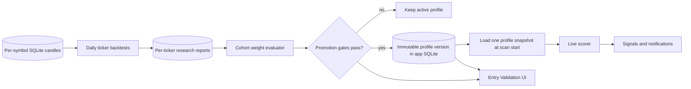

# Continuous backtest to live scoring weights

## Goal

Use recurring, causal backtests to propose and safely activate scoring weights.
The daily backtest worker remains the research producer. A cohort evaluator
decides whether a candidate is strong enough to become a versioned live scoring
profile. A promoted profile takes effect on the next signal scan.

The dashboard remains read-only with respect to execution. Weight promotion
changes signal ranking and may change qualification at the existing score floor;
it never places an order.

## Current system

- `entry_validation_scheduler.rs` refreshes registered ticker/timeframe reports
  daily, resumes after restart, yields to signal scans, shares the manual
  backtest lock, and evaluates cohorts after the daily cycle.
- `quant/core/src/evidence/entry_score.rs` fits bounded per-ticker candidate
  vectors on training data, selects exits on validation, and evaluates the
  selected policy on the chronological holdout.
- Reports are saved in `app.entry_model_validation_reports`. They retain
  aggregate evidence and candidate weights, not simulated trade rows.
- The live scorer in `quant/core/src/strategies/four_indicator_score.rs` uses
  the scan-pinned validated profile, with equal weights as its fallback.
- The Entry Validation page shows active profile versions, recent cohort
  decisions, and promotion blockers. Research reports remain separate and
  state `live_weights_changed: false`.

## Target architecture

Reuse the existing scheduler, research reports, AppState composition path,
SQLite app database, live scoring functions, API routes, and Entry Validation
page. Do not add a service, package, database, dynamic plugin loader, or
cross-layer dependency.

### 1. Profile scope

Use one shared profile per:

`score_model_id × asset_category_id × timeframe × candle_source_family`

Do not promote ticker-specific weights. The cohort evaluator fits one vector
across multiple instruments so a short run on one ticker cannot set its own live
score. App and product identities remain attached to all source reports.
Validation applies each product's own fee and execution-cost policy; reports
with incompatible sources or cost policies cannot be silently pooled. Spot,
perpetual, and other asset categories remain separate. A source-family change
creates a distinct candidate cohort.

Each cohort uses calendar-aligned training, validation, and holdout cutoffs.
Candles before the training cutoff may supply indicator warm-up, but no trade
may cross a split boundary. An instrument without the required window is
excluded with a visible reason. The cohort report records included and excluded
instrument counts and source provenance.

### 2. Cohort refresh unit

The current implementation finishes the existing resumable daily ticker and
timeframe cycle, then evaluates refreshed reports grouped by model, asset
category, timeframe, and exact candle source family. Any failed pair blocks
promotion for the cycle. This is conservative and simple to resume, though one
slow ticker delays all cohort decisions. A later optimization can persist
per-cohort cursors and evaluate a completed cohort before the whole registry
finishes.

### 3. Candidate fitting and evaluation

1. Refresh per-ticker reports from stored completed candles using the existing
   bounded, causal protocol. The fitter searches the predeclared grid on
   training bars only. A candidate needs 30 non-overlapping trades and at least
   70% wins after configured fees; candidates are ranked by their Wilson 95%
   lower bound, then mean net return and proximity to equal weights.
2. Evaluate each exact training-selected vector against cohort coverage,
   validation, holdout, fees, and app/product gates. Prefer a passing vector
   with the broadest coverage; if none passes, report blockers for the best
   covered vector. The evaluator does not average vectors or fit on holdout.
   Each ticker's selected vector uses its validation-selected exit and
   untouched holdout.
3. Aggregate only tickers with the selected exact vector. Compare validation
   and holdout metrics with the equal-weight baseline and require each
   app/product slice to pass on its own.
4. Save the bounded cohort summary and blockers. Per-trade rows are not
   persisted. Missing or fee-unknown candidates reduce cohort coverage and
   cannot silently contribute gross-only returns to the after-fee result.

### 4. Promotion gate

Promote only an exact weight vector that passed all of these checks:

- Current evaluator protocol, complete daily cycle, at least five independent
  symbols, and one exact vector shared by at least 80% of reports in the cohort
  and in every app/product slice.
- At least 730 calendar days of input history and at least 30 validation and
  holdout trades after configured transaction fees.
- Validation and untouched holdout each reach the 70% after-fee win-rate target
  and a 95% Wilson lower bound of at least 70%.
- Positive mean net return and profit factor above 1 in validation and holdout.
- The candidate beats the equal-weight baseline on mean net return in both
  validation and holdout, and every app/product slice meets the same win-rate,
  history, and coverage gates.

Training candidates, unknown-fee reports, partial cohorts, database failures,
and missing validation or holdout metrics never activate a profile. If any gate
is missing, keep the current active profile and show the blocking reasons. The
equal-weight vector `[10, 10, 10, 10]` is the default when a cohort has no active
promoted version. The reported target subtracts configured transaction fees;
spread, slippage, depth, market impact, funding, and borrow are not currently
modeled and are shown as limitations rather than included in that target.

The 730-day input-history requirement is an evidence requirement, not a candle
retention limit.

### 5. Versioned persistence

Keep each promoted version immutable in the existing app-SQLite database. The
`entry_model_scoring_profiles` table stores its scope, version, active or
superseded status, weights, protocol, promotion evaluation, and timestamp.
`entry_model_scoring_evaluations` stores the latest decision and blockers for
each scope. The profile tables do not store individual trade rows.

The stored profile fields are:

- Scope: score model, asset category, timeframe, candle source family.
- Version and status: active or superseded.
- Four integer weights, validated against the existing grid and total budget.
- Candidate protocol and source report/fingerprint references.
- Training, validation, and holdout cutoffs and aggregate metrics.
- Promotion timestamp and decision reason in the evaluation record.

Store one active version per scope with a SQLite uniqueness constraint. Promote
in a single short transaction that marks the prior version superseded and the
new version active. Candidate reports remain in the existing report table.
Invalid profiles, stale protocols, and incomplete writes fail closed to the
previous current-protocol profile or the equal-weight default.

### 6. Live scan adoption

- At scan start, load the bounded set of active profiles once and pin that
  immutable version map for the whole scan. Do not read the app database per
  ticker.
- Pass the selected profile through the existing typed scoring API. Keep raw
  NWE, DSS, relative-volume, and estimated-delta evidence visible as four
  component scores out of 10. Return the profile weights and version beside
  the computed score so the UI can explain the influence of each component.
- Use one scorer implementation for live scoring and backtest replay. Any
  change to its formula bumps the scoring model/protocol version and requires
  new validation before promotion.
- Stamp every published signal snapshot with the profile version used. Signal
  rows, screener results, and notification counts must use the same scan
  snapshot.
- A profile promoted during a scan is adopted on the next scan. It cannot mix
  versions inside one scan or retroactively change a saved research report.
- Keep the existing score scale and floor. Since reweighting can change which
  rows pass that floor, publish the updated signal and inbox counts together.

### 7. UI and operations

The existing Entry Validation page has a **Live scoring weights** panel with:

- Active profile by model, category, timeframe, and source family.
- Four component scores out of 10, current weight allocation, profile version,
  and effective scan.
- Latest candidate beside the active profile, with validation/holdout metrics,
  source, fee coverage, coverage dates, and exact promotion blockers.
- Promotion state, latest cohort metrics, and exact blockers.

The screener shows the profile version used for its latest signal snapshot. The
panel distinguishes a new candidate from a live profile and explains when the
equal-weight default is in use. Loading, partial coverage, stale evidence,
blocked promotion, database errors, and rollback each have visible status and
recovery guidance.

Active profile rows are immutable; promotion atomically supersedes the previous
version and activates the new one. The database retains prior rows for
reproducibility. A manual restore control and pause/resume control are not part
of the current UI yet.

### 8. Failure handling and resource limits

- A failed ticker report remains retryable and cannot invalidate a previously
  active profile.
- A partial or stale cohort cannot promote. The UI shows coverage and the
  failed pair.
- The profile transaction is independent from the signal-snapshot transaction;
  a profile-write failure leaves the previous profile active.
- Each scan holds one immutable profile snapshot. In-flight scans finish with
  their initial version; later scans use the newly active version.
- Candidate aggregation uses bounded per-cohort summaries and temporary
  in-memory trade observations. It writes no duplicate candle cache and no
  individual trade history.
- Keep the cohort evaluator inside the existing memory budget: process one
  bounded candle series at a time, retain only the candidate summaries and
  paired per-instrument aggregates, then release the series before the next
  ticker.
- Promotion runs after a complete eligible cohort refresh and yields to signal
  scans. Keep the existing shared backtest lock and SQLite retry policy.

The current implementation wires daily candidate fitting, cohort promotion,
versioned profile storage, scan-pinned live scoring, and the Entry Validation
status panel. Available history may still block activation. Continuous
backtesting alone is not a reason to promote a candidate; the 70% target must
clear on both validation and untouched holdout after configured fees.
