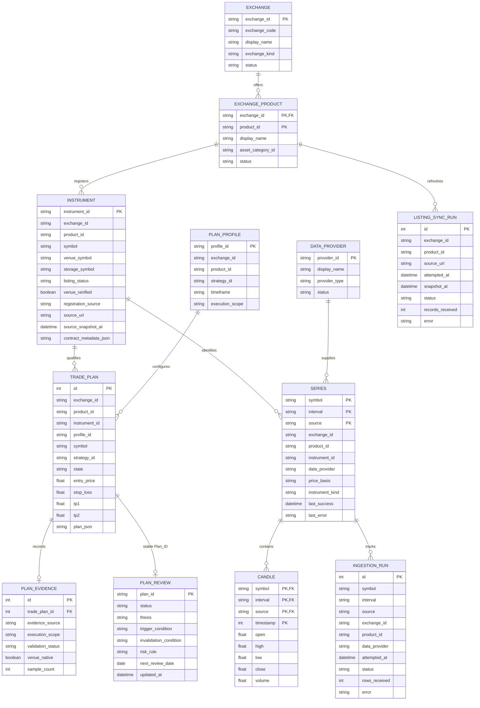

# Market data and trade plan ERD

`EXCHANGE`, `TRADE_PLAN`, and `CANDLE` are the core entities. Products and ticker registrations identify which app can produce a plan. Candle providers record where the price history came from.

## SQLite mapping

- `bars`, `series`, and `ingestion_runs` live in per-symbol SQLite files under `data/market/tickers/` (`QUANT_MARKET_DIR`), keyed by exact `storage_symbol`. `QUANT_MARKET_DB` is reserved for the explicit offline migration source.
- `exchanges`, `exchange_products`, `instruments`, `data_providers`, `plan_profiles`, `listing_sync_runs`, `trade_plans`, `plan_evidence`, `plan_reviews`, `reference_catalogs`, `instrument_registry_meta`, `instrument_exclusions`, and `stockbit_foreign_flow` live in `data/app/app.sqlite3` (`QUANT_APP_DB`).
- `EXCHANGE` and `EXCHANGE_PRODUCT` map to `exchanges` and `exchange_products`.
- App-confirmed ticker registrations live in `instruments`.
- `TRADE_PLAN` rows live in `trade_plans`; `plan_evidence` stores the plan's persisted evidence summary. `plan_reviews` stores user review separately under stable `Plan_ID`, so rescans can replace plan snapshots without replacing the review.
- `SERIES` records app, product, and provider provenance. `CANDLE` rows live in the canonical `bars` table, keyed to a series by `(symbol, interval, source)`. Provider and timeframe series remain distinct.
- Provider names such as Binance, Yahoo Finance, and Tokocrypto are cataloged in `data_providers` and recorded on `series` and `ingestion_runs`.
- Product plan profiles are stored in `plan_profiles`; listing refresh outcomes are stored in `listing_sync_runs`.
- `reference_catalogs.payload_json` holds the validated reference snapshots and embedded catalogs; queryable exchange, product, instrument, plan, and evidence fields stay in typed columns.

The app exchange and product identify the registered instrument and plan. `data_provider` identifies the candle source. Research proxy evidence keeps `venue_native = 0`. Relationships that cross the app/market file boundary are logical and validated by application queries because SQLite cannot enforce foreign keys across attached database files; `TRADE_PLAN` to `PLAN_EVIDENCE` remains in one file and retains its SQLite foreign key. Browser/server structured messages use plain JSON; provider response bodies are validated in memory and are not persisted as received.

## Entity rules

These rules apply at the entity boundaries shown in the ERD. The [storage contract](market-data-storage.md) remains the source of truth for database and file-storage policy; the [provider contract](exchange-data-providers.md) owns adapter capabilities and acceptance checks.

### EXCHANGE

- `exchange_id` identifies the app exchange selected for classification. Keep it distinct from the upstream candle provider and venue-native data status.
- Plans and registered instruments inherit their app identity from this entity; provider discovery cannot change it.

### EXCHANGE_PRODUCT

- A product belongs to exactly one app exchange. Treat `(exchange_id, product_id)` as its identity.
- Product eligibility comes from its approved listing source and product contract. An incomplete or failed refresh does not replace the last verified listing.

### INSTRUMENT

- The active registered instrument universe is the authority for plan generation and candle selection. Candle data alone cannot register an instrument.
- Preserve logical, venue, and storage symbols separately, along with listing status and registration provenance. Unverified registrations remain pending.
- Tokocrypto tokenized stocks remain categorized under Tokocrypto. Stockbit IDX storage symbols use the `.JK` form; this does not establish Stockbit execution availability.

### DATA_PROVIDER

- This entity identifies the upstream market-data source, not the selected app exchange or execution venue.
- Provider adapters validate and return typed records. Raw upstream payloads are not persisted or forwarded through application APIs.

### PLAN_PROFILE

- A profile binds an app product to a strategy identity, strategy timeframe, and execution scope.
- Strategy parameters and thresholds are owned by the strategy policy. Consumers use that policy rather than maintaining profile-specific copies.

### TRADE_PLAN

- A plan must resolve to an eligible registered instrument and a compatible product profile. Its app and product identity come from that registration.
- A plan is review data, not an order instruction. Signal, validation, price position, and execution-review status remain separate facts.

### SERIES

- A series is identified by `(symbol, interval, source)` and keeps app exchange, product, instrument, and provider provenance.
- Keep each provider/source in its own series. Never splice native and proxy candles together or relabel proxy data as venue-native.

### CANDLE

- `bars` is the canonical candle history, keyed by `(symbol, interval, source, timestamp)`. Do not create a second persisted chart dataset.
- Persist validated typed OHLCV rows with their source identity. Missing history stays missing; charts must not fabricate or forward-fill candles.

### INGESTION_RUN

- Record each provider attempt with app/product/provider identity, row count, outcome, and failure detail when available.
- Keep failed attempts visible and preserve source labels. Do not store raw provider responses in the run record.

### LISTING_SYNC_RUN

- Record listing refresh attempts for the specific app product, including source, time, outcome, and received-record count.
- A failed or incomplete result preserves the last verified instrument universe and exposes the refresh failure.

### PLAN_EVIDENCE

- Evidence belongs to a specific plan and preserves its source, execution scope, validation status, venue-native flag, and sample count.
- Only matching validated evidence supports performance claims. Research-proxy evidence remains non-native and cannot satisfy venue-execution validation.
